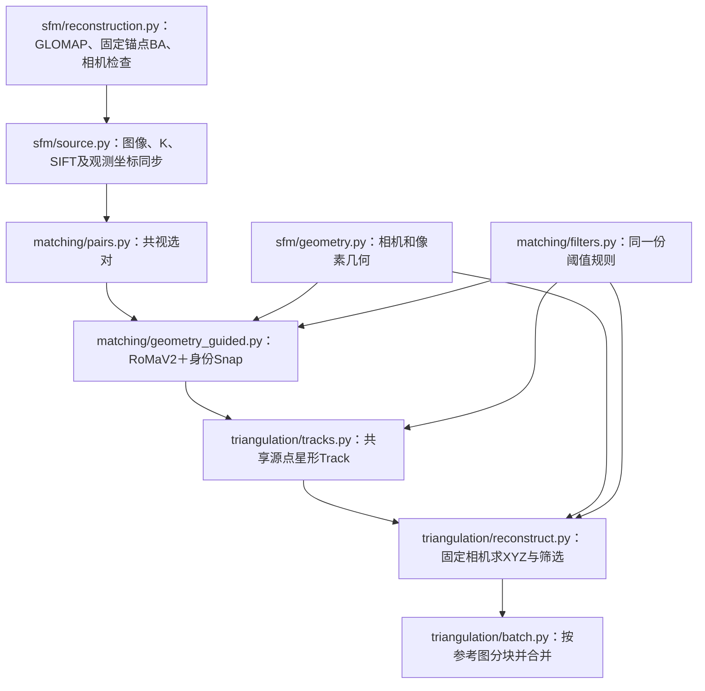

# SfM → matching → triangulation 核心整理

本文记录SfM、matching、triangulation从历史实验脚本到功能目录的整理，保持已有数值算法、坐标、匹配预算和筛选规则。原工程入口、运行任务及`repository/`快照不修改。主链保持独立，不自动运行旧DIM、前馈深度或GS训练。后续已完成的[道路提取／拟合／增密整理](road/README.md)直接消费本链三角化输出；[DA3／Pi3X模块](depth_prior/README.md)和[GS初始化／固定道路训练](gs/README.md)通过单独入口显式启用。后续的[展示](visualization/README.md)及[1000帧／重叠GS队列](pipeline/README.md)已整理，仍与数据准备、模型推理边界分开。

## 保留的数据耦合，拆开实验入口依赖

这三部分必须共用相机、像素和观测身份。问题是原来的函数归属，而不是这些数据需要共享：`geometry_guided_matching`为了查询RoMa，导入`run_shared_observation_tracks`；后者又导入`run_snap_v11`和`snap_v11_pipeline`的历史对照入口。

当前调用关系如下。没有增加类、注册器、算法切换框架或新的配置系统。



`sfm/source.py`读取SIFT数据库时调用`matching/sparse.py`的身份一致性检查。这是相机分辨率交接时必须验证的数据库契约，不通过旧匹配实验实现。

## 模块归属与调用

| 文件 | 负责什么 | 主要接口 |
| --- | --- | --- |
| [sfm/reconstruction.py](sfm/reconstruction.py) | SfM各阶段、固定锚点BA及验收 | `run_block(output, index, block, reference_cameras, *, repo_root, colmap, glomap)` |
| [sfm/source.py](sfm/source.py) | 原生裁剪图与相机／数据库同步 | `prepare_source(root, low_source)` |
| [sfm/geometry.py](sfm/geometry.py) | 排序读取相机、射线、极线和参数转换 | `model_data`、`rays`、`epipolar_error` |
| [matching/pairs.py](matching/pairs.py) | 共视评分与连接图 | `select_pairs(model, images, initial_budget, budget, min_neighbors=3)` |
| [matching/geometry_guided.py](matching/geometry_guided.py) | 特征、双向查询、锚点核验及Snap | `match_all(root)` |
| [matching/seeds.py](matching/seeds.py) | 固定源点与稠密场查询 | `image_seeds`、`query_matches` |
| [matching/sparse.py](matching/sparse.py) | SIFT身份、SP/LG离线权重和mask读取 | `sift_data`、`offline_sparse_weights`、`valid_mask` |
| [matching/snap.py](matching/snap.py) | 完整双端证据、源身份保持、精度单位 | `identity_snap`、`snap_two_endpoints`、`precision_to_original` |
| [matching/romav2_runtime.py](matching/romav2_runtime.py) | 离线RoMaV2及DINOv3资源与稠密场采样 | `load_model`、`query_field` |
| [matching/filters.py](matching/filters.py) | 读取已有manifest的阈值并检查双视图更严格 | `shared_filter_settings` |
| [triangulation/tracks.py](triangulation/tracks.py) | 从直接匹配缓存建立共享源点Track | `build_shared(root, pairs, anchor_names=None)` |
| [triangulation/geometry.py](triangulation/geometry.py) | DLT、XYZ优化、鲁棒初始化及真实候选修复 | `project_batch`、`robust_initial`、`repair_track` |
| [triangulation/reconstruct.py](triangulation/reconstruct.py) | 完整Track验收与点云／观测导出 | `reconstruct(root, policy, built)` |
| [triangulation/batch.py](triangulation/batch.py) | 分块计算、合并和全局Track ID偏移 | `triangulate(root, policy='B1', chunk_size=100)` |
| [io_utils.py](io_utils.py) | 各阶段共用的原子文件写入、PLY导出及SHA256 | `write_json`、`save_npz`、`export_ply`、`sha` |
| [pipeline/reconstruct.py](pipeline/reconstruct.py) | 调用已准备实验的匹配或三角化阶段 | 模块命令入口 |

SfM不再读取`exp142_config`或修改其它模块的`OUT/SFM_BLOCKS/OLD_DATA`。`block=(first, stop, anchor_stop)`，调用者显式给出本批参考相机文件：首批来自已有锚点，后批来自上一批的`cameras.npz`。SfM仍使用既有666×370 PINHOLE内参和原来的GLOMAP／BA参数，不扩展成通用相机标定工具。

## 阶段交接的约定

### SfM → matching：相机、数据库与像素必须一起交接

- `model_data`按图像名排序；`image_index`指此排序中的下标，不能当作COLMAP的`image_id`。
- Pose为world-to-camera：`X_cam = R @ X_world + t`。三角化只优化世界坐标XYZ，不动Pose或K。
- 当前666×370和900×500来自相同的`crop=900:500:190:0`；转换比例为`900/666=500/370`。900×500图像从原视频重新取，不插值放大旧JPEG。
- K、SIFT关键点及其尺度、稀疏Point2D坐标、数据库相机和F/H一起变换。数据库图像／特征索引、配对身份、Pose和稀疏XYZ保持不变，并重新核对模型与数据库的Point2D对应。
- COLMAP采用边缘原点像素，像素中心为`x+0.5,y+0.5`。SP/LG关键点进入本链时加0.5；mask和取色索引采用`floor(xy)`。RoMa场查询使用`align_corners=False`。
- SfM/RoMa有效mask为动态有效与非天空有效的交集。缓存目录沿用`sky_masks/foreground_valid_hard`旧名字，但其中实际是此交集；不能误认为只有天空mask。GS的天空监督规则不在此改变。
- `prepare_source`要求输入manifest明确记录`signature.video_path`，缺失时直接失败，不再静默猜测另一个旧视频路径。

### matching → Track：共享的是源身份，不是坐标近邻

每张图固定一组源点：最多500个未注册SIFT、1000个SuperPoint，再用有效区域分层自由点补足到当前每图20000点。一个已选pair只执行一次双向RoMa预测，从两端各查询20000点，合计40000行。

Snap锚点来自数据库SIFT／共同稀疏Point3D，以及SP＋LightGlue独立配对。锚点先通过mask、RoMa双向对应、overlap和极线检查；只有来源特征身份相同且双端证据完整时才修正目标坐标。参考源坐标不动，歧义或冲突保留原始RoMa坐标。

| 缓存字段 | 下游如何解释 |
| --- | --- |
| `source_side`、`seed_index` | 源点属于pair的哪一端，以及该图固定源点数组中的哪一行 |
| `raw0/raw1`、`final0/final1` | 原始及Snap后观测；后续真实Raw候选修复需要保留两者 |
| `raw_overlap/raw_cycle`、`sigma_max_original_px` | 双向可靠性及换算到原图像素的预测标准差 |
| `raw_eligible`、`raw_cached_joint_pass`、`final_epi` | 原有有效性与双视图联合证据；保持旧字段含义，不因整理重命名 |
| `existing_id`、`snap_status` | 已有稀疏身份及Snap状态，防止把已有SfM点重复当作新点 |

Track键为`(reference image_index, seed_index)`；同一个源点直接匹配到所有选中邻居，形成星形Track。**不做A→B→C坐标传递，不用0.25px近邻合并不同源身份。** 不同参考图的星形Track仍分开，可能描述同一表面；当前没有物理表面去重。若源坐标跨pair变化，立即报错。

### Track → triangulation：保留几何证据和双视图门槛

使用已知相机做鲁棒DLT初始化，再优化XYZ。异常处理仍限于已有真实匹配候选：Snap导致的目标观测异常可以尝试原始RoMa观测，必须满足身份和全部几何检查；没有足够一致观测就拒绝Track。这里保留的是当前主链已有行为，没有加入深度模型修复。

当前1000帧批次的阈值来自其manifest，未改成早期默认值：

| 规则 | 多视图／通用 | 最终仅保留2视图 |
| --- | --- | --- |
| overlap下限 | 0.35 | 0.5 |
| 往返误差上限 | 3 px | 1.5 px |
| 极线误差上限 | 3 px | 1.5 px |
| 三角化最大夹角下限 | 1° | 2° |
| 最大重投影误差 | 3 px | 1.5 px |
| 预测标准差上限 | 不加此双视图门槛 | 10 px |

视图数按异常处理后实际保留的观测数计算。三视图减到双视图仍必须过双视图门槛；参考源观测必须保留。相机正深度、有限值和重投影检查不删除。

当前选对仍是可靠稀疏共视策略：Point3D误差≤1px且Track长度≥3；最大共视生成树保证连通，填满1800对，再优先补欠缺邻居的图像，最后按共视分数补到3600对。时间间隔2–8且共同点≥30只是补邻居时的偏好，不是全局邻域限制；**这版不在选对时逐点统计夹角，夹角在三角化时验收。**

共同点数按每图的唯一Point3D ID集合计算。2026-10-24复查发现实际GLOMAP有重复ID，原`assume_unique=True`交集不成立，现已修复；完整499500对经独立集合交集核对，最终3600对中186对变化。预算、可靠点门槛及选图规则不变，历史缓存不回写。

### 分块只是内存边界

每次选择100张**参考图**，仍使用它们在整个1000帧配对图中的全部选定邻居，不把邻居截断在这100张图内。合并Track ID按各块候选Track总数偏移，不能按已接受点数偏移；点与保留观测的offset一起合并。

新产物使用`B1_chunk00_shared`等带policy的分块名；最终仍为`B1_shared/new_points.npz/.ply`与`point_observations.npz`。候选Track和观测证据留在各块，最终`metrics.json`记录`track_sources`。已完成块沿用原有完成标记继续使用；变更输入、阈值或代码时须另建实验，不复用旧完成标记。

## 如何调用，以及本轮没有迁移的部分

整理后的SfM、原生图像适配和选对提供上表中的直接函数接口。SfM要求先准备原有`frames_manifest.json`、mask、`sfm/block_XX/images`；图像适配要求准备低分辨率source及其manifest。视频抽帧和SAM道路mask仍属于输入侧；准备好原生资产后的1000帧队列已由`pipeline/cloud.py`串联。首次使用以[Pipeline手册](pipeline/README.md)的顺序为准。

匹配／三角化命令读取准备好的**独立新实验目录**。在仓库根目录执行：

```bash
python -m GLRMap_GS.pipeline.reconstruct --help
python -m GLRMap_GS.pipeline.reconstruct match /path/to/new_experiment
python -m GLRMap_GS.pipeline.reconstruct triangulate /path/to/new_experiment --policy B1 --chunk-size 100
```

`new_experiment/manifest.json`沿用已有`source`、`policies`、`seeds_per_image`、`per_pair_cap`、`filter_settings`和`matcher_overrides`。匹配前还需准备`shared/seeds`、`shared/superpoint`、`shared/direct_pairs`、`shared/sky_masks/foreground_valid_hard`及对应mask文件。复用已有匹配做CPU三角化时，保持完整同源manifest与缓存，不复制不相容的种子或配对。

RoMaV2、DINOv3、离线权重及各Python环境通过 `paths.local.json` 配置；入口使用独立包 `GLRMap_GS`。安装与迁移见[根README](README.md)。

批处理设置`repair_enabled=True, snap_enabled=True, compute_holdouts=False`；没有执行留出诊断，质量标签为0，不以此宣称独立几何验证。底层显式请求留出的能力保留。道路阶段已提供`pipeline.reconstruct road <root> --output <new_output>`，其曲面拟合留出规则见道路说明；整理后的ReSplat／GS衔接与队列见[Pipeline手册](pipeline/README.md)；历史运行队列没有自动切换。

## 本轮核对结果

契约检查命令：

```bash
python -m unittest GLRMap_GS.triangulation.test_contracts -v
```

15项检查通过：SfM mask及输入保护、相机相似变换、失败命令不标完成、双视图阈值、固定采样、RoMa查询单位、Snap身份、三视图关联及源坐标不变、非等焦距PINHOLE投影／Jacobian／XYZ、真实证据修复、空结果、分块Track ID偏移，以及重复ID共视计数、缺失分块不占用输出目录、不同源图的亚像素取色。

另以现有`sanhuan_340s610s_glomap1000_roma_20261022/block_00/roma`只读缓存核对整理前后的实现：

- 初次迁移时，1000张相机的3600对与已有配对逐条一致；该结果保留了原重复ID计数问题。2026-10-24已修正，不能再据此声称当前选对与旧版一致，详见上文。
- 对已有1000帧SfM模型，在临时目录分别执行整理前后的相机验收与导出，`audit.json`全部字段和`cameras.npz`全部数组一致，验收通过；未重新优化SfM。
- 取参考图`003200.jpg`及其3条直接匹配连接，整理前后均构建10027条候选Track；源坐标、观测、置信度、原始候选和身份数组完全一致。
- 同一批Track用原代码和整理代码分别在临时目录重建，均接受**4328点，其中432个双视图点、3896个多视图点**。
- 两份`new_points.npz`、`point_observations.npz`、`tracks.npz`、`all_holdouts.npz`共24个数组逐项完全一致；PLY字节相同。除运行时间外的指标也一致。
- 初次迁移时14个匹配／查询／Track／数值求解函数的AST与快照相同；后续局部优化见[当前实现与检查](README.md#检查)。1832份快照SHA256不变。新模块导入不加载旧实验入口。

该核对覆盖本次模块迁移和一张真实参考图的三角化等价性，没有重跑完整1000帧三角化、GLOMAP或GPU匹配，也没有启动新训练。现有实验和产物保持原样。
