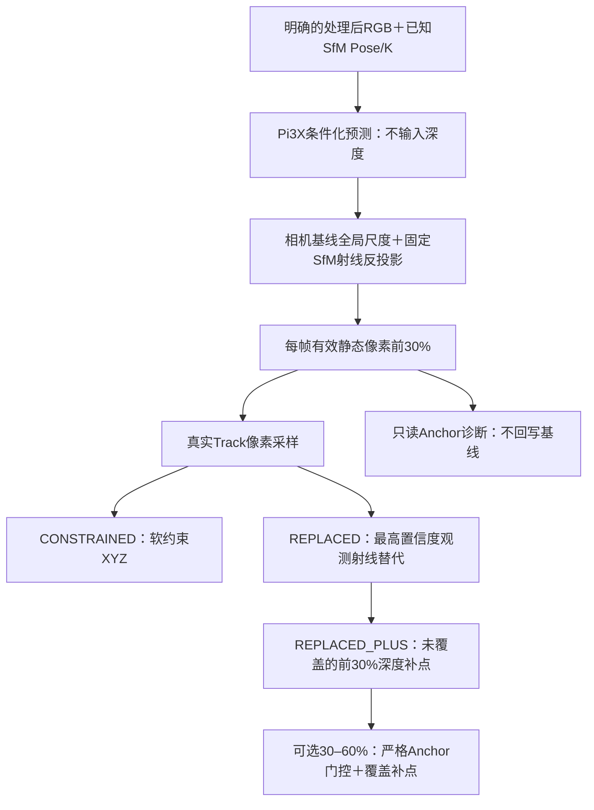

# 可选前馈深度先验

运行主线与可选支线的边界见[Pipeline手册](../pipeline/README.md#可选深度模块入口与验证范围)。以下预测、置信度和XYZ操作只在显式调用本模块时生效，不自动替换曲面道路或GS输入。


已整理DA3／Pi3X相机条件化推理、缓存映射、置信度筛选、真实Track深度约束、锚点诊断及补点。沿用`minimal-implementation`，将算法从历史实验／对照／绘图入口中提取；没有恢复旧DIM、Pose BA或旧的独立深度清理执行入口。

这是**显式启用的可选模块**。SfM → matching → triangulation → road仍可独立运行，当前RoMaV2＋ReSplat／GS队列没有自动接入本目录。

## 文件与归属

| 文件 | 当前职责 |
| --- | --- |
| [mapping.py](mapping.py) | 验证并准备既有RGB/Pose/K，读取相机，单次相机尺度对齐和缓存映射检查 |
| [pi3x_inference.py](pi3x_inference.py) | 全部Pose/K参与条件化的Pi3X原始预测；保存实际条件mask及SDK／权重哈希 |
| [da3_inference.py](da3_inference.py) | 固定PINHOLE相机条件化DA3；保存全量深度、置信度和处理后K |
| [cache.py](cache.py) | 两种明确缓存格式→统一采样字段；输入文件哈希与完成前核对 |
| [sampling.py](sampling.py) | 双线性采样、真实观测像素映射、相机射线和处理后像素网格 |
| [refinement.py](refinement.py) | 鲁棒重投影＋log深度损失，仅优化XYZ；最高置信度观测射线替代 |
| [anchors.py](anchors.py) | 可靠SfM锚点、局部连续表面、四态证据及30–60%区间判定 |
| [anchor_maps.py](anchor_maps.py) | 只读前30%诊断／SfM＋原RoMa锚点的前60%诊断，保存逐帧证据 |
| [cloud.py](cloud.py) | 固定／原生相机反投影、源像素记录、覆盖半径与无Track补点合并 |
| [track_pipeline.py](track_pipeline.py) | 前30%约束／替代／补点及几何保护下的DA3纯筛选 |
| [band_pipeline.py](band_pipeline.py) | 保留已认可前30%融合，仅补充通过锚点的30–60%区间 |
| [filter.py](filter.py) | DA3直接对称深度误差投票与强几何保护规则 |
| [da3_constraints.py](da3_constraints.py) | 既有低夹角DA3约束和XYZ拟合内核，独立于纯筛选 |
| [test_contracts.py](test_contracts.py) | 迁移后的数值、身份、坐标和产物约定检查 |
| [../pipeline/prior.py](../pipeline/prior.py) | 准备、导出、约束、诊断、分带和筛选的明确命令入口 |

相机几何复用`sfm.geometry`，XYZ投影／Jacobian复用`triangulation.geometry`，mask索引复用`matching.sparse`，文件写入复用`io_utils`。为了可靠SfM锚点的最大夹角计算，在`sfm.geometry`补入原有`angle_degrees`；原函数未更改。

移除的是新模块对`compare_exp54_legacy_dim`、旧实验`REFERENCE/LEGACY`路径、`run_adaptive_cleanup`执行入口和绘图脚本的依赖。原快照、正式缓存和历史对照产物保持原位。

## 实际存在的流程



这张图描述当前代码。MD中的完整A/B/C来源管理、将`depth_prior_weight`逐像素接入三角化、逐点跨视图补点校验、重复深度层处理和Pose恢复不是本轮新增的算法。

当前前30%基线使用高置信度样本的二值valid来约束XYZ；Anchor阶段会输出`depth_prior_weight`，但没有偷偷把新权重乘入已认可基线。30–60%是独立可选扩展，采用局部Anchor门槛，不改变原前30%融合结果。

## 坐标、尺度和输入缓存

- SfM采用world-to-camera；Pi3X输入`poses`采用OpenCV camera-to-world。保存两者并相互核对。
- `prepare_conditions(source, cached_rgb, output)`只复用明确缓存中的`image/intrinsics/extrinsics/image_names`；核对当前帧名、相机和原图至处理后K的缩放，不从旧DIM实验恢复数据或猜测crop。当前实验常用504×280，宽高须为14的倍数。
- Pi3X所有视角的Pose和ray条件为True，深度条件为False。网络输出相机是**软条件化结果**，不宣称与输入Pose完全相同。
- `PI3X_FIXED`采用输入SfM相机、处理后K和模型预测Z；预测Z只乘一次相机基线估计的全局尺度。`PI3X_NATIVE`采用预测局部点和预测相机，再做同一个全局相机相似变换。
- 相似变换的旋转来自相机朝向，尺度／平移来自相机中心；不使用道路点或深度拟合尺度，不按帧／patch重新定标。即使对齐残差小，也不是预测深度准确的证明。
- DA3缓存已经处于固定SfM相机和尺度中，直接使用保存的处理后K与camera-Z，不额外拟合尺度。映射检查已去掉EXP54专用900×500／666×370硬编码，改为实际图像尺寸和K核对。
- 支持PINHOLE独立`fx/fy`。本轮修正原Anchor及低夹角跨视图投影默认两轴同焦距的假设；等焦距历史样本保持原数值。

Pi3X不需要DA3的预测深度。共享DA3处理后RGB只是原实验保持相同输入图像的方法；数据准备阶段也可显式提供相同字段的RGB／相机缓存。

采样函数不再接收原来被忽略的`confidence_quantile`参数；实际阈值统一在缓存字段构造阶段确定，采样只读取该阈值。

`pi3x_fields`读取`input_conditions.npz`、`pi3x/prediction.npz`、`pi3x/inference.json`和`camera_alignment.json`，检查帧顺序、Pose、native K、处理后K、图像／点图尺寸及条件化标志。没有静默重新配准或错误时换用另一份旧缓存。

## 置信度、Track和补点

1. **前30%**：每帧在静态、有限、正深度像素内对raw confidence logits取0.7分位，`conf>=threshold`；没有额外绝对下限。阈值相等的像素都保留，数量不必恰好30%。
2. **真实像素采样**：用保留的二维Track观测和原图K构造射线，再映射至保存的处理后K采样深度。不会把当前三维估计投到另一个二维位置寻找深度。
3. **软约束**：保持相机、K、二维观测与Track ID，只优化XYZ；使用重投影Huber与log深度Huber，默认`depth_sigma=.02`、8轮。无可用深度的点原样保留。
4. **直接替代**：从可用观测中选最高置信度的真实观测射线，按其深度重建XYZ。导出float32后重新计算重投影／夹角、清除已调整点旧质量和留出标签，报告非正深度及大重投影，不冒充重新验收通过。
5. **前30%补点**：在替代后的已有点云之外，按一个处理后深度像素的空间足迹`Z/min(fx,fy)`做覆盖判断。保留源图像、源像素、RGB与confidence；这是覆盖判断，不是独立精度检查，也不进行体素融合。

混合云`REPLACED_PLUS`中，`point_origin=0`表示原真实Track（XYZ可能已调整），`1`表示前30%预测补点；后者`track_ids=-1, track_length=0, quality=0`。原Track观测另存在`REPLACED/point_observations.npz`，不能假设它覆盖混合云每一行。

当前来源标记不是完整A/B/C质量分级。C类预测点不回填到SfM数据库，不参与Pose BA，也不生成虚拟Track。原`road/`拟合若要消费深度调整结果，应使用带真实观测的Track分支，不能把混合云当作全量已验证Track。

## Anchor诊断和30–60%扩展

前30%只读诊断沿用：原SfM点至少3视图、最大静态观测重投影≤2px、最大夹角≥3°。在相同观测像素计算`log(Z_prior/Z_sfm)`；32×32处理后像素网格内按4连通和相邻log深度跳变≤0.05限制传播，不跨mask／深度边界。

每个局部表面至少3个不同Anchor，才判断可靠／冲突。Anchor ID模5为0的点在所有视角均只作留出评估，不能投门控票。四态为`not_selected/reliable/unknown/unreliable`；unknown不等于错误。默认一致门槛为`median(|log error|)<=log(1.10)`和MAD≤0.05，冲突门槛为`median(|log error|)>=log(1.20)`。

相机对齐旋转误差>3°或中心误差／首尾相机跨度>2%的帧不授予强／弱先验，保留原因。这里是先验适用性检查，不运行新的Pose优化。

30–60%扩展使用原SfM和**未经Pi3X调整的RoMa**锚点；RoMa要求至少3视图、夹角≥3°、最大重投影≤1px。处理后4×4像素格只取一名代表，避免密集同源星形点放大票数。SfM与RoMa的ID用偶／奇编号区分。

扩展门槛保持原值：中位log残差≤`log(1.05)`、MAD≤0.03、P90绝对log残差≤`log(1.10)`，且状态为reliable。unknown权重为0。前30%原样保留；新通过区域还要经过相对原融合点云的覆盖判断才追加，`point_origin=2`。新点无Track。

## DA3的两个独立用途

- `filter_da3`遵循最后确认的筛选：几何强点（≥3视图、夹角≥3°、最大重投影≤1px）直接保护；其它点在真实观测像素读取每帧前30%DA3，相对深度误差>20%、至少2个冲突视角且超过可靠观测半数才剔除。前后两侧均可投冲突票，无证据点保留，不优化XYZ，不做遮挡／深度边界或留出筛选。
- `da3_constraints.constraints/depth_fit`保留之前已授权的低夹角辅助三角化内核：检查有限正深度、相邻视图支持、遮挡和深度层冲突，至少2条可用深度后按夹角调整权重并拟合XYZ。它与上述纯筛选规则分开，也没有接入新的Pi3X默认路径。低夹角Track恢复的整段编排仍留在原快照，未自动降低主链三角化夹角门槛。

## 入口和输出

在仓库根目录使用已配置环境；每次指定新的输出位置。以下仅为调用示例，本轮没有执行推理或新实验：

```bash
# 准备精确处理后RGB／相机，输出一个新NPZ文件。
python -m GLRMap_GS.pipeline.prior prepare --source SOURCE --cached-rgb CACHED.npz --output NEW_RAW_PRIOR/input_conditions.npz

# Pi3X：使用已有环境和权重，不安装／下载模型。
/home/luvision/anaconda3/envs/vggt_omega/bin/python -m GLRMap_GS.depth_prior.pi3x_inference --input NEW_RAW_PRIOR/input_conditions.npz --output NEW_RAW_PRIOR/pi3x --ckpt CHECKPOINT.safetensors

# 固定相机点云、前30%约束／替代／补点、只读Anchor诊断。
python -m GLRMap_GS.pipeline.prior export --source SOURCE --prior NEW_RAW_PRIOR --output NEW_PRIOR
python -m GLRMap_GS.pipeline.prior refine --reference ROMA_ROOT --prior NEW_PRIOR --output NEW_COMPLETION
python -m GLRMap_GS.pipeline.prior anchors --reference ROMA_ROOT --prior NEW_PRIOR --output NEW_ANCHORS

# 可选30–60%扩展，或复用已有DA3缓存进行保护筛选。
python -m GLRMap_GS.pipeline.prior band --reference ROMA_ROOT --prior NEW_PRIOR --baseline NEW_COMPLETION --output NEW_BAND
python -m GLRMap_GS.pipeline.prior filter-da3 --reference ROMA_ROOT --prior DA3_PRIOR.npz --output NEW_FILTER
```

新的DA3原始推理入口为`python -m GLRMap_GS.depth_prior.da3_inference --source SOURCE --output NEW_DA3`，使用原有DA3环境、源码和本机缓存模型。两种推理依赖均在实际run时加载，普通帮助／缓存分析不会加载模型。

固定相机导出包含`PI3X_FIXED/PI3X_NATIVE`；约束包含`CONSTRAINED/REPLACED/REPLACED_PLUS/PI3X_ADDED`；Anchor包含逐帧`maps/*.npz`与`summary.json`；扩展包含`anchor_maps/NEW_FILL/FUSED_AFTER`及门控选择；DA3筛选包含`KEPT/REJECTED`与选择记录。输入哈希在读取前记录、完成前核对。

本轮不迁移旧对比绘图、路面画幅或HTML脚本，输出几何／证据供`visualization/`后续接入。没有增加自动调度、模型provider注册器或通用实验配置框架。

## 核对与限制

```bash
OPENBLAS_NUM_THREADS=1 python -m unittest GLRMap_GS.depth_prior.test_contracts -v
```

32项检查通过，复用原来的Anchor、置信度分带、相机对齐、Track深度和DA3投票检查；补充了缓存准备→约束／替代→补点→证据不足分带的完整小样本路径、DA3保护筛选、不同fx/fy的锚点／跨视图投影和低夹角约束。2026-10-24新增两项插值检查：有效整数像素不受零权重NaN邻居污染；有效小数插值、边界钳制及画幅外判定保持原约定，正权重缺失邻居不会被填补。

实际缓存核对使用既有EXP59前30%实验和EXP54 DA3缓存，所有验证产物在临时目录：

- 100帧Pi3X采样字段和全局尺度与原实现完全一致；固定与原生两份点云各2619222点，XYZ、RGB、源图像／像素和confidence逐项等于现有产物。
- 4096条真实双视图Track中1633条有可用高置信度深度；采样值、valid、软约束XYZ与直接替代XYZ完全一致。
- 2439个合格稀疏Anchor与原选择一致；`000100/000140/000199`三张原有诊断图的状态、误差、组件和证据数组一致。
- 同三帧的SfM＋原RoMa合并Anchor、局部状态、P90及30–60%接受mask与历史扩展结果一致，分别通过4596、7397、9422个区间像素；仅在临时目录运行这三个帧的诊断循环。
- EXP54的100帧已条件化DA3采样字段与原实现一致，尺寸检查已改为实际K／画幅。
- 原1832份源码快照哈希保持不变。没有重新运行Pi3X／DA3 GPU推理、完整段融合、GLOMAP或GS训练；推理入口做了导入／命令行检查，新的SDK运行结果未在本轮重测。

文档提出的完整A/B/C门控和独立几何精度验收仍须另行实验。本轮核对证明当前实现迁移的数值一致性，不证明模型在新场景的预测准确度。
