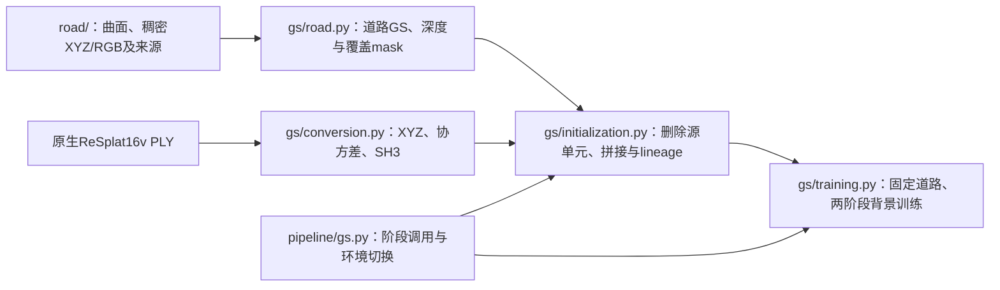

# 高斯初始化与固定道路训练

已将当前100视角RoMa道路＋ReSplat的道路适配、世界坐标转换、混合初始化和两阶段训练提取到本目录。道路数学直接复用整理后的`road/`，不导入旧DIM实验或试跑脚本中的`SOURCE/OUT/FIRST`全局变量。原脚本、源码快照、模型及后台队列保持原样。

## 阅读顺序与职责



| 文件 | 责任／主要接口 |
| --- | --- |
| [road.py](road.py) | `road_gaussians`保持XYZ/RGB，计算曲面法线与扁平高斯；`prepare_assets`写入单窗道路PLY、来源、深度及实际覆盖mask |
| [conversion.py](conversion.py) | `conversion`处理原生ReSplat的XYZ、源相机局部旋转和SH3方向，不拟合尺度 |
| [initialization.py](initialization.py) | `source_masks`按源单元删除动态／已替换道路；`road_targets`检查实际覆盖；`prepare`快照输入、审计转换、拼接并保存lineage |
| [training.py](training.py) | `train`拥有损失／学习率、道路六组参数冻结、checkpoint和信号中断处理 |
| [state.py](state.py) | 既有JSON参数读取、相机入口检查、GPU锁、输入／代码哈希及续训一致性 |
| [rendering.py](rendering.py) | 初始化审计及visualization共用的gsplat渲染，不编排视频或HTML |
| [../pipeline/gs.py](../pipeline/gs.py) | `road-assets/plan/prepare/train/run/status`；顺序切换两个环境，拥有流水线输出锁与阶段产物校验 |

ReSplat模型推理使用本库[原生入口](../tools/run_resplat_forward_windows.py)，SDK位置在 `paths.local.json` 的 `resplat` 配置。本GS模块消费原生PLY；完整推理由 `pipeline.window` 串联。1000帧13窗队列见[pipeline/gs_queue.py](../pipeline/gs_queue.py)，横移轨迹和展示见[visualization/](../visualization/README.md)。

## 保留的关键约定

1. **100视角、16个上下文。** 10FPS、100张连续且按序的`000000.jpg`格式图像名；上下文为`linspace(0,99,16,dtype=int)`。相机NPZ为4×4 world-to-camera和像素K；同窗K一致，Graphdeco要求偶数画幅、中心主点。本版道路监督仍为666×370，不能直接使用900×500的源像素索引。
2. **道路参数跨窗口一致。** 保留本窗及后续100帧来源的道路点，并补入16个上下文可见的道路点；所有窗口共用完整道路批次的第三块曲面切向参考。重叠源行17字段一致；颜色转SH0，opacity=.6，切向sigma=.7×spacing、法向sigma=.12×spacing。`nx/ny/nz`沿用零占位；真实法线存于来源NPZ、方向写入四元数。
3. **只替换曲面实际覆盖的道路。** 在静态道路整数像素调用`road.query_surface`，生成正camera-Z和`correction_mask`。曲面无支持处保留ReSplat初始化，它们仍可训练，不能称为全部语义道路冻结。初始化逐帧核对替换mask等于深度覆盖mask，拒绝误用整个语义道路mask。
4. **原生PLY需要完整坐标转换。** ReSplat的16×128×240=491520行按源上下文分块；XYZ为pivot相对坐标，四元数为源相机局部方向。保持原float32相机归一化次序，同时转换协方差与SH3。保留world／centered渲染对照（PSNR>40dB、平均灰度差<.3），有原生视频时额外检查>28dB。
5. **按源单元删除，不膨胀。** 动态mask的0表示忽略，覆盖mask的255表示新道路实际覆盖；INTER_AREA缩至240×128后只要源单元存在这类像素就删除对应ReSplat行，并保存原行号。天空mask只诊断，真实天空RGB继续监督。完整RoMa非道路点云没有作为本版背景输入。
6. **两阶段背景训练，固定道路全部参数。** 默认每阶段每视角10步，即1000＋1000。RGB损失为`.8 masked_L1 + .2 (1-masked_SSIM)`，仅动态mask排除RGB。第一阶段逆深度权重`.5→.05`，第二阶段`.05`；XYZ学习率重置相对阶段进度，Adam状态连续。固定Pose/K、道路六组参数及点数，不增密、不剪枝。增加预算会同步延长阶段学习率与深度日程，不引入Loop背景生长分支。
7. **完整恢复。** checkpoint含参数／Adam、spatial LR scale、剩余视图栈、Python／Torch／CUDA RNG、逐视图计数和累计时间。默认250步和阶段末保存；SIGTERM／SIGINT完成当前步后保存并返回75。恢复核对配置、输入／快照和代码哈希，跳过阶段前核对产物；最终道路PLY逐字段字节一致。

## 调用与输出

首次使用请按[Pipeline手册第3–4节](../pipeline/README.md#3-为单窗或13窗gs准备输入与完整配置)准备道路、原生ReSplat及完整配置，再运行队列。下方命令仅说明已有输入后的单阶段接口；不再要求从历史配置补齐字段。

道路适配接收整理后的`road`产物：曲面必须显式保存`first/stop`，`source_image_index`必须对应完整相机NPZ排序。旧曲面省略窗口字段时需显式转存到新目录，不猜测文件名或改写历史产物。

```bash
# CPU道路适配；输出必须是新目录，不触发ReSplat或训练。
/home/luvision/anaconda3/envs/resplat/bin/python -m GLRMap_GS.pipeline.gs road-assets \
  --dense ORGANIZED_ROAD --cameras NATIVE_CAMERAS.npz \
  --road-masks ROAD_MASKS --dynamic-masks VEHICLE_VALID_MASKS \
  --first-frame 3350 --output NEW_ROAD_ASSETS

# 使用Pipeline手册生成的完整配置，output必须是独立新目录。
python -m GLRMap_GS.pipeline.gs plan --config NEW_CONFIG.json

# 用户需要运行时执行；本轮没有执行这两条。
/home/luvision/anaconda3/envs/resplat/bin/python -m GLRMap_GS.pipeline.gs run --config NEW_CONFIG.json
/home/luvision/anaconda3/envs/resplat/bin/python -m GLRMap_GS.pipeline.gs run --config NEW_CONFIG.json --resume
```

配置的`road_ply/road_constraints/road_depth/reference_cameras`依次指新适配目录的`road_gaussians.ply`、`road_constraints.npz`、`road_depth_targets.npz`、`reference_cameras.npz`；`road_masks`指`covered_road_masks/`。`resplat_ply`指原生导出，不能预转换后重复输入。图片、动态mask、ReSplat视频、GPU锁和Python环境字段沿用既有设置；横移配置不触发本入口渲染。

输出为`static_road_init.ply`、世界坐标ReSplat、`initialization_lineage.npz`、`inputs/road_depth.npz`、相机／图像／mask及代码快照、审计报告；训练产出`checkpoint_latest.pt`、阶段末`trained/point_cloud/iteration_1000|2000/point_cloud.ply`、进度和`training_report.json`。新实现使用独立指纹，不直接接管历史目录续训；旧`dim`名称仅在快照保留。

## 已做核对与限制

```bash
OPENBLAS_NUM_THREADS=1 python -m unittest \
  GLRMap_GS.triangulation.test_contracts \
  GLRMap_GS.road.test_contracts \
  GLRMap_GS.depth_prior.test_contracts \
  GLRMap_GS.gs.test_contracts -q
```

60项CPU检查通过，新增9项覆盖道路参数／共同行身份、源单元删除、实际覆盖、正深度、原生上下文、预算、输入哈希和锁释放。`plan/--help`不加载模型或CUDA渲染。

对既有`group_02_003350_003450`做了只读数值核对：

- 在临时目录完整生成100帧道路适配产物：1529830个道路GS的17字段字节一致，来源行／法线、参考相机、约束、全100帧深度和覆盖mask逐项等于原产物；旧曲面窗口信息只在临时副本中显式补充。
- 全100帧覆盖／深度输入检查通过；491520个ReSplat单元的动态删除、道路删除及保留行一致，保留360858行。
- CPU执行原／新转换，491520行的62字段world和centered结果一致；world结果逐字段等于原保存PLY。SH3基变换最大误差约`1.11e-15`。
- 临时CPU小模型／渲染替身执行训练循环：连续20步等于第7步中断后续13步的参数、Adam、随机视图栈、RNG及每视图计数，六组道路参数不变。这不等于CUDA渲染或显存测试。
- 原1832份源码快照哈希不变。未运行ReSplat推理、真实GS训练或视频渲染，旧队列未切换入口。

运行仍依赖ReSplat环境中的`plyfile/gsplat`、Graphdeco环境中的CUDA扩展，以及外部 `gs_backend` 下的 `scene/gaussian_renderer/arguments/utils`。安装与外部路径配置见[根README](../README.md)。
