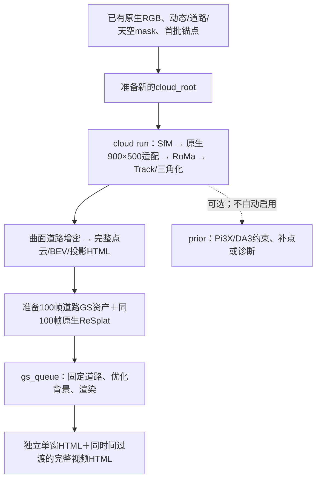

# 三环Pipeline使用手册

这是整理后代码的统一运行入口。按下面的顺序执行即可从**已有三环图像／mask资产**完成新点云、道路、GS和离线展示；各功能README解释算法，不再另外维护一套运行顺序。

**范围：** 当前支持本机已有环境、10FPS、666×370中心crop、固定针孔内参及已有首批锚点。原视频抽帧、SAM／DA-V2推理尚未迁入`data_preparation/`；全新视频且没有这些输入时，不能直接运行本手册。`repository/`和`reference_configs/`是来源快照，不是可直接运行的工作目录。

## 推荐入口：指定一个窗口，一条命令跑到GS与变道视频

正式脚本是 [`window.py`](window.py)，运行时不导入 `experiments/` 下的脚本。它固化了394–396秒验证成功的流程：

```text
准备好的RGB／mask／原视频／首批相机锚点
  → 新GLOMAP，或显式复用已核验的SfM
  → 在整批稀疏几何上选对，只匹配涉及目标窗口的图像对
  → RoMaV2＋SIFT／SuperPoint-LightGlue Snap
  → 仅目标参考帧的共享Track、固定相机三角化
  → 仅目标窗口的道路曲面拟合与像素射线增密
  → 同窗口原生ReSplat16上下文推理
  → 静态背景＋拟合道路GS初始化
  → 两阶段背景训练，固定道路全部参数
  → 原轨迹、定点左右横移、前进变道；PNG＋MP4＋PLY
```

**范围不会自动扩大。** 目标20帧就是20张三角化参考图、20张道路取色图和20张GS监督图；匹配可以使用窗口外的直接邻居。1000帧是SfM上下文，不是自动处理1000帧点云或训练1000帧GS的指令。当前支持单次20–100帧窗口；多窗拼接仍使用下方原有队列。

### 输入必须先准备好

本入口服务于当前三环同类数据：10FPS、原图中心crop900×500，SfM／GS图像为666×370，固定针孔内参和既有首批锚点。SfM当前固定K为`fx=fy=545.6095244714393,cx=333,cy=185`，原视频取crop为`x=190,y=0,w=900,h=500`；**不能把另一套相机／裁剪的数据直接放进来冒充兼容输入。**

输入目录采用已有点云批次结构：

```text
input_root/
  plan.json                        # fps=10、blocks、source_video、first_anchor
  frames_manifest.json             # image、sha256、video_time_nominal等原记录
  matching_settings.json           # matcher_overrides、filter_settings
  frames/003200.jpg ...             # 完整SfM批次的666×370 RGB
  masks/vehicle_valid/003200.png ...# 255有效静态，0动态忽略
  masks/road/003200.png ...         # 255道路
  sky_all/foreground_valid_hard/003200.png ... # 255非天空，0天空
  sfm/block_00/...                  # 仅--reuse-sfm时需要已有完整SfM
```

`plan.json`的一批示例：`{"fps":10,"blocks":[[3200,4200,3300]],"source_video":"/绝对路径/video.mp4","first_anchor":"/绝对路径/cameras.npz"}`。从已准备好的三环资产构建该输入，见下文第1节。原视频不可省略：RoMa输入是重新抽取900×500的原crop，不是将666×370 JPEG放大。原视频抽帧到原生监督图、SAM道路／动态mask及DA-V2天空推理仍是上游数据准备，**本入口不自动生成这些资产**。

### 一键运行

从仓库根目录执行。以下命令在新输出目录重算匹配、三角化、道路、ReSplat和GS；`--reuse-sfm`明确复用此次已完成的相机，且检查RGB／静态mask与原SfM审计一致：

```bash
cd /home/luvision/zjn/GLRMap_GS
python -u -m GLRMap_GS.pipeline.window run \
  --input /data/sanhuan/cloud \
  --output experiments/my_394_396_run \
  --block 0 --first-frame 3840 --stop-frame 3860 --reuse-sfm
```

`stop-frame`不包含在窗口中。当前三环显示秒数是`10+frame/10`，所以394–396秒对应`[3840,3860)`。新数据必须沿用自己的帧号与时间记录，不把这个10秒偏移套到所有视频。

- 想先核对范围，将命令的`run`改成`plan`：只读元数据、显示20帧／400步，不启动GPU、不创建输出。
- 输入尚无SfM时，**去掉`--reuse-sfm`**：自动为选定1000帧批次运行SfM，再只处理指定窗口。第2批及以后使用前批相机作为100帧锚点，需先备好该锚点。
- 换区间时修改`--first-frame/--stop-frame`、必要时修改`--block`，并给新的`--output`。输入计划的批次数量不会触发其它批次自动运行。
- 匹配设置默认读取输入目录的`matching_settings.json`，也可通过`--settings`指定。沿用每图20000个共享源点、每对最多40000个双向查询；先按整批3600对几何预算选对，再保留涉及目标窗口的对，不会对其余对运行RoMa。
- 三套外部Python可通过`--python-sfm`、`--python-resplat`、`--python-gs`覆盖；启动本命令的Python必须是RoMa环境。其它源码、COLMAP／GLOMAP、权重及本机路径见[迁移清单](../README.md#迁移所需的项目与配置)。

后台运行可把同一条命令放进tmux：

```bash
tmux new-session -d -s sanhuan_window \
  'cd /home/luvision/zjn/GLRMap_GS && OPENBLAS_NUM_THREADS=1 python -u -m GLRMap_GS.pipeline.window run --input /data/sanhuan/cloud --output experiments/my_394_396_run --first-frame 3840 --stop-frame 3860 --reuse-sfm > /tmp/sanhuan_window.log 2>&1'
```

前台和后台示例是两种启动方式，**不要对同一输出目录都执行一次**。

### 这版实际采用的规则

- 共享参考源点跨邻居复用，配对Snap校正保留原始RoMa候选供修复；固定SfM Pose/K三角化，二视图点使用比多视图更严格的筛选。具体阈值来自输入settings，复制到输出manifest中。
- 道路点至少有两个有效道路观测，且道路观测占比≥75%。高质量道路Track拟合带留出核验的局部曲面；每隔2像素射线求交、空间去重取色，保持非道路原始XYZ/RGB。新增拟合道路不伪装成匹配Track。
- ReSplat使用窗口内均匀16个上下文，保持输入相机；20帧有4个留出视图。按源像素删除动态高斯，只在曲面实际覆盖区替换道路，未覆盖的ReSplat道路仍可训练。
- GS固定所有道路参数、相机和内参；训练背景，不生长／剪枝。动态mask屏蔽RGB监督，**天空RGB参与训练**。两阶段各`视图数×10`步：20帧共400步，100帧共2000步。
- 本入口不自动加入Pi3X／DA3、Pose BA、车道线专项修复或跨窗高斯融合。外插幅度沿用已验收的SfM世界单位参数，不宣称单位是米。

### 输出与成功判定

| 输出目录下的路径 | 内容 |
| --- | --- |
| `progress.json` | 当前阶段、失败原因、阶段耗时及最终执行检查 |
| `plan.json` | 本次输入、窗口、SfM上下文及训练预算 |
| `cloud/block_00/roma/B1_shared/new_points.ply` | 仅目标参考帧产生的完整RoMa点云 |
| `dense_road/ROAD_fitted/new_points.ply` | 拟合增密道路 |
| `dense_road/FUSED_AFTER/new_points.ply` | 非道路原始点＋稠密拟合道路 |
| `dense_road/comparison/camera_projection.png` | 原图及完整点云投影 |
| `dense_road/comparison/road_bev_side.png` | 同坐标BEV／侧视 |
| `gs/review/*.png` | 原图／ReSplat／初始化／训练后及横移关键帧 |
| `gs/trained_forward.mp4` | 原轨迹最终渲染 |
| `gs/original_resplat_init_trained_forward.mp4` | 四栏完整对比视频 |
| `gs/init_vs_trained_lateral.mp4` | 定点左右外插，初始化／训练后对照 |
| `gs/forward_lane_change.mp4` | 原轨迹／前进变道对照 |
| `gs/trained/point_cloud/iteration_400/point_cloud.ply` | 20帧模型；100帧对应iteration_2000 |

只输出PNG／MP4，不生成HTML导航页。`status=complete`表示子进程全部成功、训练视图／预算正确、道路参数逐位固定及渲染检查通过；不把它当作所有场景画质都自动通过。需要查看标线连续性、边缘拉伸和外插视频。

输入和历史实验不回写；输出必须是新目录。子进程失败即停止，保留日志和产物，不自动换算法、清理或重试。此最小串联入口不提供整链`--resume`；可检查失败阶段后使用相应已有模块恢复，或显式换新目录重跑，不能仅凭残留目录判定完成。GS自己的checkpoint续训机制仍在。

2026-10-26已使用以上正式命令实跑394–396秒：显式复用本次SfM，重新推理46对RoMa，生成231405个三角化点、125543个拟合道路点，完成400步训练及全部渲染，总耗时135.6秒。与此前认可版本比较，原始点的XYZ／RGB／Track长度／误差和拟合道路XYZ／RGB／来源像素逐项一致（局部Track编号不参与等价判断）。这次没有再次重跑1000帧SfM；无`--reuse-sfm`分支调用此前已运行通过的SfM入口。历史运行记录保留在迁移前工程的实验目录中。迁移后结果见根README。

---

以下为各阶段的手动操作及原有1000帧／多窗口队列，**局部验证请优先用上面的一键窗口入口**。



## 0. 工作目录、环境和三种批次

换机器部署时，先对照[项目／环境／权重／配置迁移清单](../README.md#迁移所需的项目与配置)。下面的`/home/luvision/...`是当前机器路径；venv、外部项目软链接及ReSplat固定路径都需要单独恢复，不能仅复制整理目录。

所有命令在独立的 **GLRMap_GS仓库根目录** 执行；先激活matching环境并完成四个环境的包安装。外部路径由 `paths.local.json` 配置。

```bash
export repo_dir=/home/luvision/zjn/GLRMap_GS
cd "$repo_dir"
export roma_python="$(command -v python)"
export resplat_python="$(python -c 'from GLRMap_GS.runtime import python_for; print(python_for("resplat"))')"
```

| 用途 | 现有运行环境／输入 |
| --- | --- |
| SfM | `python_sfm`、`colmap`、`glomap`配置项。环境名字不代表调用旧DIM算法 |
| RoMa／CPU几何／点云展示 | matching环境（`python_matching`），本机现有RoMaV2、DINOv3、SP/LG离线权重与pycolmap；不自动安装或下载 |
| ReSplat／GS审计渲染 | `resplat`环境、`resplat`配置指向的SDK及缓存checkpoint；原生入口使用既有GPU锁并等待至少18000MiB空闲显存 |
| GS训练 | `python_gs`配置项，现有Graphdeco CUDA扩展；由单窗流水线自动切换 |
| 抽帧、视频、图片 | 现有FFmpeg／ffprobe及各环境的PIL／OpenCV／Matplotlib |

- SfM：每批1000帧，批间重叠100帧；三批共有2800个唯一视角。
- 三角化：完整1000帧选对图不变，只按100张**参考图**分块，邻居不截断。
- GS：每窗100帧、步长75、重叠25帧；1000帧对应13窗。默认每窗1000＋1000步，共26000步。

## 1. 准备一个全新的点云工作目录

以下实例只读复用已保存的三环原生RGB、mask和参考锚点，**不复用旧重建输出、不恢复DIM**。先做第一批；需要三批时，在准备前将脚本中的`blocks`改为原计划的三项。

```bash
export native_root=/data/sanhuan/prepared_batch
export cloud_root="$repo_dir/experiments/new_cloud"
"$roma_python" - <<'PY'
import json, os, shutil
from pathlib import Path
from PIL import Image
from GLRMap_GS.io_utils import write_json
src, dst = Path(os.environ['native_root']), Path(os.environ['cloud_root'])
old = json.loads((src/'plan.json').read_text())
blocks = old['blocks'][:1]  # 全三批用old['blocks']；每项[first, stop, anchor_stop]
records = {r['image']: r for r in json.loads((src/'frames_manifest.json').read_text())}
frames = sorted({n for first, stop, _ in blocks for n in range(first, stop)})
dst.mkdir(parents=True, exist_ok=False)
folders = ['frames', 'masks/vehicle_valid', 'masks/road', 'sky_all/foreground_valid_hard']
for folder in folders:
    (dst/folder).mkdir(parents=True)
for n in frames:
    name = f'{n:06d}.jpg'
    assert Image.open(src/'frames'/name).size == (666, 370)
    (dst/'frames'/name).symlink_to((src/'frames'/name).resolve())
    for folder in folders[1:]:
        mask = src/folder/f'{n:06d}.png'
        assert Image.open(mask).size == (666, 370)
        shutil.copy2(mask, dst/folder/mask.name)
for i, (first, stop, _) in enumerate(blocks):
    images = dst/'sfm'/f'block_{i:02d}'/'images'
    images.mkdir(parents=True)
    for n in range(first, stop):
        (images/f'{n:06d}.jpg').symlink_to((dst/'frames'/f'{n:06d}.jpg').resolve())
write_json(dst/'frames_manifest.json', [records[f'{n:06d}.jpg'] for n in frames])
write_json(dst/'plan.json', dict(fps=10, blocks=blocks,
    first_anchor=old['first_anchor'], source_video=old['source_video']))
reference = json.loads((src/'block_00/roma/manifest.json').read_text())
write_json(dst/'matching_settings.json', {k: reference[k] for k in ['matcher_overrides', 'filter_settings']})
print(dst)
PY
```

准备脚本只创建新目录、链接RGB并复制mask／元数据。首批锚点和原视频必须可读；`frames_manifest.json`的`sha256`在SfM入口核对。道路mask应为已精修版本。准备失败的半目录不自动清理，不能把`exist_ok=False`改成覆盖旧实验。

当前三环显示时间是`10+frame/10`；`video_time_nominal`是原长视频的**提取时间**。二者不同，不要重写时间字段或从缩放JPEG伪造900×500原图。

## 2. 点云队列：先看计划，再运行

```bash
"$roma_python" -m GLRMap_GS.pipeline.cloud plan "$cloud_root"
"$roma_python" -u -m GLRMap_GS.pipeline.cloud run "$cloud_root" \
  --settings "$cloud_root/matching_settings.json"
```

`plan`只读元数据，不验证所有文件、也不占GPU。`run`会启动SfM与RoMa；它按顺序在独立进程中执行：

| 阶段 | 主要输出，相对于cloud_root | 下一阶段读取 |
| --- | --- | --- |
| `sfm` | `sfm/block_00/cameras.npz`、`anchored/sparse/0/`、`database.db`、`audit.json` | 原生666×370相机、私有模型／数据库 |
| `matching-inputs` | `block_00/low_source/`、`block_00/roma/source/`、`roma/manifest.json`、`pairs.txt` | 重新抽取的900×500图、同步的K／SIFT、3600对 |
| `match` | `block_00/roma/shared/{direct_pairs,seeds,superpoint}/` | 真实RoMa候选、共享源点和Snap证据 |
| `triangulate` | `block_00/roma/B1_shared/new_points.npz/.ply`、观测和指标 | 原始完整三角化点云 |
| `road` | `block_00/dense_road/{ROAD_shared,ROAD_fitted,FUSED_AFTER}/`、`surfaces/` | 原始道路、稠密曲面道路、完整合成点云 |
| `report` | `block_00/dense_road/comparison/` | 三维、完整投影、BEV及统计 |

初始1800对、最终3600对、每图20000个源点和参考分块100由`pipeline/cloud.py`中的队列常量定义；`--settings`只提供匹配器设置和筛选阈值，不是另一份点数／选对预算。后续批次自动使用上一批相机作为100帧锚点。

首次完成后直接下载：

- `block_00/dense_road/comparison/raw_3d_interactive.html`：完整三维展示，每组展示上限25万点，标明原始／展示数量。
- `block_00/dense_road/comparison/bev_projection.html`：全量点云投影与同尺度BEV／侧视。
- 完整点云位于`block_00/dense_road/FUSED_AFTER/new_points.ply`；仅道路为`ROAD_fitted/new_points.ply`。

HTML内嵌全部展示资源，下载单文件即可离线打开；不生成index。密度／训练视图误差不是独立几何精度证明。

只需要直接查看图片／视频时，`cloud run`、`visualization.report` 和单窗 `visualization.gs` 均可加 `--png-only`，关闭 HTML 输出，保留 PNG／视频和统计。该选项不改变匹配、三角化、拟合或训练；GS 多窗队列仍沿用原展示方式。

需要重画展示时，不重跑匹配或拟合：

```bash
"$roma_python" -m GLRMap_GS.visualization.report \
  "$cloud_root/block_00/dense_road" --output "$cloud_root/block_00/view_check" \
  --branches FUSED_BEFORE FUSED_AFTER ROAD_shared ROAD_fitted --image-name 003700.jpg
```

该图像名必须存在于本批相机中。`cloud`的单阶段接口接收**cloud_root**；`pipeline.reconstruct`接收**block_00/roma**；`visualization.report`接收**block_00/dense_road**，这三种根目录不能互换。

## 3. 为单窗或13窗GS准备输入与完整配置

点云与曲面阶段全部成功后再做本节。使用**整批1000帧曲面及其原始source_image_index**；不能把曲面裁成100帧再编号。监督RGB／相机是原生666×370，不能使用`roma/source`中的900×500图和K。

```bash
export gs_root="$cloud_root/gs_windows_first"
export gs_stop=3300  # 首次只准备[3200,3300)；全13窗用4200，并改为一个新的gs_root
"$resplat_python" - <<'PY'
import hashlib, json, os, subprocess
from pathlib import Path
from GLRMap_GS.gs.road import prepare_assets
from GLRMap_GS.io_utils import write_json
from GLRMap_GS.pipeline.gs_queue import windows
from GLRMap_GS.runtime import GPU_LOCK, python_for
repo, cloud, out = (Path(os.environ[k]) for k in ['repo_dir', 'cloud_root', 'gs_root'])
python = os.environ['resplat_python']
cameras = cloud/'sfm/block_00/cameras.npz'
dense = cloud/'block_00/dense_road'
out.mkdir(parents=True, exist_ok=False)
configs = []
for index, (first, stop) in enumerate(windows(3200, int(os.environ['gs_stop']))):
    window = out/f'group_{index:02d}_{first:06d}_{stop:06d}'
    window.mkdir()
    assets = window/'road_assets'
    prepare_assets(dense, cameras, cloud/'masks/road', cloud/'masks/vehicle_valid', first, assets)
    # 原生ReSplat入口已迁入本库tools/。
    label = 'review_'+hashlib.sha256(str(window).encode()).hexdigest()[:16]
    for suffix in ['.mp4', '_vs_original.mp4']:
        if (repo/'output_video'/(label+suffix)).exists():
            raise FileExistsError('Native video label already exists; inspect the earlier run')
    shared = ['--images', str(cloud/'frames'), '--cameras', str(cameras),
              '--frame-manifest', str(cloud/'frames_manifest.json'), '--out', str(window/'resplat'),
              '--start', str(first), '--stop', str(stop), '--label', label]
    for stage in ['prepare', 'run']:
        subprocess.run([python, '-u', str(repo/'tools/run_resplat_forward_windows.py'), stage, *shared],
                       cwd=repo, check=True)
    native = window/'resplat/segments/segment_00'
    config = dict(output=str(window/'gs'), first_frame=first, stop_frame=stop, fps=10,
        images=str(cloud/'frames'), cameras=str(cameras), reference_cameras=str(assets/'reference_cameras.npz'),
        resplat_ply=str(native/'gaussians.ply'), resplat_video=str(native/'video.mp4'),
        road_ply=str(assets/'road_gaussians.ply'), road_constraints=str(assets/'road_constraints.npz'),
        road_depth=str(assets/'road_depth_targets.npz'), road_masks=str(assets/'covered_road_masks'),
        dynamic_masks=str(cloud/'masks/vehicle_valid'), sky_diagnostic_masks=str(cloud/'sky_all/foreground_valid_hard'),
        gpu_lock=str(GPU_LOCK),
        steps_per_view_per_phase=10, checkpoint_every=250,
        python_resplat=python, python_gs=python_for('gs'))
    path = window/'pipeline_config.json'
    write_json(path, config)
    configs.append(str(path))
write_json(out/'queue.json', dict(output=str(out/'queue_results'), configs=configs,
                                 blend_frames=10, minimum_free_disk_GiB=20))
print(out/'queue.json')
PY
```

这段准备命令会执行**CPU道路适配和GPU ReSplat推理**，但还没有开始GS训练。原生入口还在仓库`output_video/`写入带唯一label的视频，不改写旧视频。没有这些本机资产或希望从全新视频推理时，应先补齐输入侧，不能把快照中的硬编码路径当作已完成配置。

关键配置只有一份：上面生成的`group_XX_.../pipeline_config.json`。`road_masks`必须指实际曲面覆盖的`covered_road_masks/`；`dynamic_masks`保留255=静态、0=动态约定。原生ReSplat PLY尚未转世界坐标，不能预转换后重复输入。初始化会保留曲面未覆盖处的ReSplat道路；天空RGB继续训练。算法和PLY字段见[GS说明](../gs/README.md)。

单窗准备失败时保留日志／半成品，先确认失败阶段；不要直接重跑整个准备脚本覆盖目录。本机原生ReSplat入口有自己的输入清单与失败处理；下面的`--resume`只负责**已经准备好输入之后的GS队列**。

## 4. GS训练、渲染及后台运行

```bash
"$roma_python" -m GLRMap_GS.pipeline.gs_queue plan --queue "$gs_root/queue.json"
"$resplat_python" -u -m GLRMap_GS.pipeline.gs_queue run --queue "$gs_root/queue.json"
```

`plan`要求配置中的道路资产、原生ReSplat PLY和相机已经存在；它不准备资产、不启动推理。`run`验证相邻25帧相机及共同道路行，逐窗执行`pipeline.gs run`与`visualization.gs`，训练后才渲染。队列结果目录`queue_results/`必须尚不存在或为空；各窗资产／模型位于同级group目录。

后台执行可把**同一条run命令，使用展开后的绝对路径**放入tmux；不要把`plan`当作后台训练入口。队列已经负责进程顺序、GPU锁、磁盘保留、信号转发、checkpoint和阶段标记，不需要再套一个自动重试框架。

| 想查看什么 | 相对于gs_root的位置 |
| --- | --- |
| 当前窗口／状态 | `queue_results/progress.json`、`queue_results/group_XX_pipeline.gs.log`等日志 |
| 已完成各窗效果，集中下载 | `queue_results/html/group_XX.html` |
| 全区间同时间过渡视频／离线HTML | `queue_results/joined_forward.mp4`、`queue_results/html/full_forward.html` |
| 单窗模型与checkpoint | `group_XX_.../gs/trained/point_cloud/iteration_2000/point_cloud.ply`、`checkpoint_latest.pt` |
| 训练计数／输入／渲染核验 | 各窗`gs/{training_report,input_manifest,visualization_complete}.json` |

道路全部参数固定，背景默认两阶段各1000步、不增密／剪枝；Pose/K不优化。窗口的25帧共同监督与视频中间10帧溶解是不同概念，预览**没有融合高斯模型**。各组HTML内嵌四段视频：原轨迹、原图／初始化／训练后、定点横移及前进变道。

只想操作单个已配置窗口时：`pipeline.gs plan/run/status --config ...`负责初始化／训练；`visualization.gs --config ...`单独负责渲染。`pipeline.gs --stop-after`仅对`train`阶段有效，不是整个`run`的停止参数。

## 5. 恢复与失败的含义

| 情况 | 正确操作 |
| --- | --- |
| 点云队列中断 | 同一`cloud run ... --settings ...`加`--resume`；输入、设置和代码必须一致 |
| GS队列中断 | 同一`gs_queue run --queue ... --resume`；checkpoint恢复Adam／采样栈／RNG，不从仅模型PLY续训 |
| 只剩`matching_report.json`，pair／seed缓存已清理 | 明确重建匹配缓存；不能跳过匹配直接宣称可续跑，也不恢复DIM |
| 输入适配／道路等阶段留下未提交完成标记的半目录 | 检查半成品、确认可保留来源或使用新的目录；队列不会自动清理或猜测成功 |
| 修改源码、阈值、相机、mask或配置 | 另开运行目录；指纹保护不是可以绕开的可选校验 |
| 只想重画点云HTML／投影／BEV | 执行`visualization.report`，不要重新训练或重做三角化 |
| GS返回75／76／其它非零码 | 分别为中断已处理、磁盘保留不足、具体子进程失败；先看进度及对应日志 |

点云阶段只在子进程成功后写`block_XX_STAGE.done.json`，核对核心产物哈希；匹配缓存另检查存在及文件大小，实际数组契约由消费模块检查。GS还核对逐视图预算、道路冻结、PLY及展示哈希。完整性检查、进程边界和GPU锁都有当前职责，保留，不精简成“看到报告就跳过”。

## 可选深度、模块入口与验证范围

`prior.py`是Pi3X/DA3的显式可选支线，缓存格式、置信度和`prepare/export/refine/anchors/band/filter-da3`命令见[depth_prior说明](../depth_prior/README.md)。本手册的点云／道路／ReSplat背景GS主链不自动读取前馈融合结果；不能把`prior`输出直接改名当作`ROAD_fitted`。

入口职责：`cloud.py`为1000帧点云队列；`reconstruct.py`为准备好`roma/`后的单阶段几何；`gs.py`为单窗；`gs_queue.py`为重叠GS队列。算法说明分别见[SfM](../sfm/README.md)、[matching](../matching/README.md)、[triangulation](../triangulation/README.md)、[road](../road/README.md)、[gs](../gs/README.md)和[visualization](../visualization/README.md)。

2026-10-24的模块级检查和示例检查已被后续394–396秒完整GPU验证补充；当前独立库安装、检查及验证范围见[根README](../README.md)。历史实验与快照保持原样。

## 2026-10-26：394–396秒短窗完整链路验证

已在20视图上贯通RoMa三角化、局部道路拟合、原生ReSplat、GS初始化、两阶段训练和原轨迹／横移／变道渲染。SfM与匹配复用本次新计算缓存；没有继续1000帧三角化。历史结果保留在原工程 `superDIM/experiments/sanhuan_review_394s396s_only_20261025/`，迁移后验证见根README。执行检查通过；细节画质仍有标线模糊和边缘拉伸，不宣称全部视觉问题解决。

短窗参数：原生ReSplat入口增加`--segment-frames 20`，`pipeline.gs road-assets`增加`--num-frames 20 --tangent-patch-index 0`（本局部输入只有一个曲面）。单窗GS配置设置`first_frame=3840, stop_frame=3860, lateral_anchors=[5,10,15]`；上下文按实际20帧均匀选16帧，训练按每视角每阶段10步自动得到400步。默认100帧队列不变，多窗队列仍使用100帧窗口。
